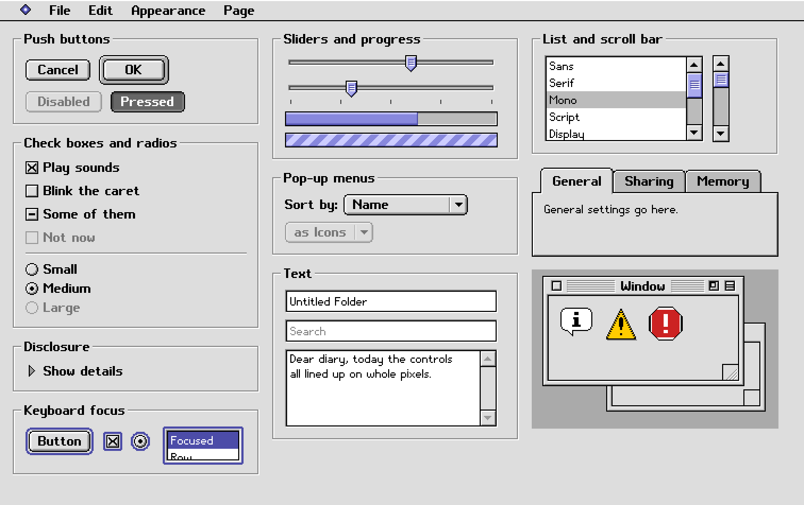
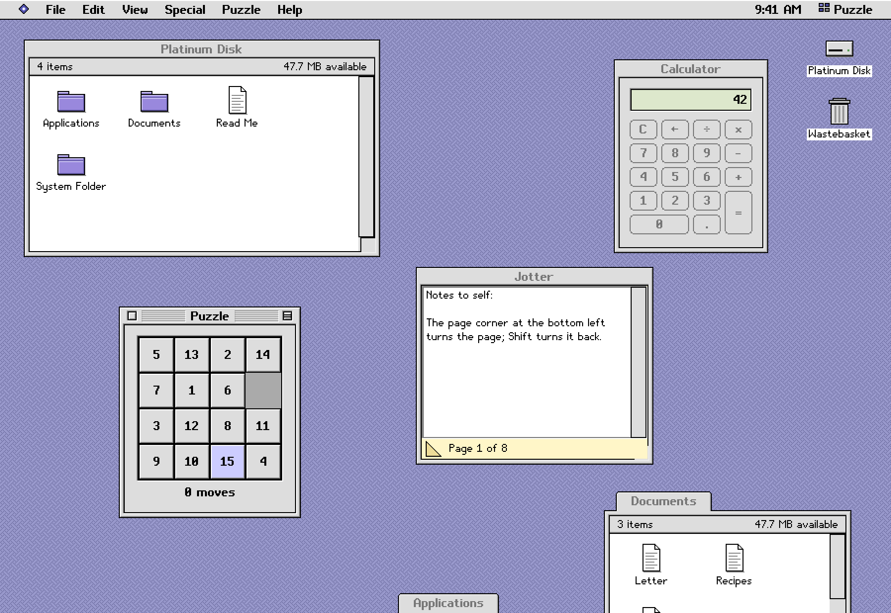

# mygo-platinum

English | [简体中文](README.zh.md)

[](https://github.com/firede/mygo-platinum/actions/workflows/verify.yml)
[](https://pkg.go.dev/github.com/firede/mygo-platinum)

A set of controls for [MyGo](https://mygo.egoist.dev)'s native UI in the
style of the gray, beveled late-1990s "Platinum" desktop look — drawn pixel
by pixel on the GPU, with no web view — and a "classic desktop" example that
puts them to work.



More: [page 2](docs/gallery-2@2x.png) (bevel buttons, toolbar, fields,
status, rich text, pop-up windows), [page 3](docs/gallery-3@2x.png) (lists,
tables, layout),
[page 4](docs/gallery-4@2x.png) (dates, colors, sheet, ruler),
[page 5](docs/gallery-5@2x.png) (documents and navigation).

> **A tribute in style only.** This project is not affiliated with, endorsed
> by or connected to Apple Inc. It uses none of Apple's fonts, icons, images
> or trademarks: its Latin bitmap faces, its icons and every picture in it
> were drawn for it, its East Asian glyphs come from the open Fusion Pixel
> Font, and its design specification ([docs/spec.md](docs/spec.md)) is
> written from scratch.

> [!WARNING]
> **An early, personal project.** It was made for its author's own use and
> is shared as it is, with no promise of support. Its API may change in any
> 0.x release, and it is built on MyGo v0.5.1, itself young and changing.
> Pin a version, and expect to adapt.

## What is in it

| Control | Function |
|---|---|
| Push button, default and cancel buttons | `Button` |
| Check box (with a mixed state) | `Checkbox` |
| Radio button and radio group | `Radio`, `RadioGroup` |
| Slider (with tick marks) | `Slider` |
| Progress bar, determinate and indeterminate | `ProgressBar` |
| Disclosure triangle | `Disclosure` |
| Group box and separator | `GroupBox`, `Separator` |
| Tab control | `TabControl` |
| Pop-up menu | `PopupMenu` |
| Text field, password field, text area | `TextField`, `TextArea` |
| List box (with icons, dimmed rows) | `ListBox` |
| Scroll bar | `ScrollBar` |
| Window frame: striped title bar, close, zoom and collapse boxes, resize corner, path menu | `Window` |
| Menu bar, menus, submenus, keyboard equivalents | `MenuBar` |
| Alert box, movable modal dialog | `Alert`, `Dialog` |
| Text in the bitmap faces | `Label`, `TextIn`, `Paragraph` |
| Bevel button, icon button, toggle, segmented control | `BevelButton`, `IconButton`, `Segmented` |
| Toolbar with an overflow menu | `Toolbar` |
| Little arrows, number field, search field | `Stepper`, `NumberField`, `SearchField` |
| Chasing arrows, placard, window header, badge, tag, image well | `ChasingArrows`, `Placard`, `WindowHeader`, `Badge`, `Tag`, `ImageWell` |
| Help balloon, context menu | `Balloon`, `ContextMenu` |
| Tree view, sortable table, icon view | `TreeView`, `Table`, `IconView` |
| Split, scroll view, utility window | `Split`, `ScrollView`, `Window` with `Utility` |
| Calendar, date picker, time field | `Calendar`, `DatePicker`, `TimeField` |
| Combo box, color well and color picker | `Combobox`, `ColorWell` |
| Spreadsheet sheet with formulas, formula bar | `Sheet`, `FormulaBar` |
| Find and replace dialog, ruler | `FindReplace`, `Find`, `ReplaceAll`, `Ruler` |
| Column view, document tabs, font picker, page setup | `ColumnView`, `DocumentTabs`, `FontPicker`, `PageSetup` |
| Progress dialog, banner, toasts, empty state | `ProgressDialog`, `Banner`, `Toasts`, `EmptyState` |
| Path pop-up, breadcrumb, pagination, card, status bar | `PathPopup`, `Breadcrumbs`, `Pagination`, `Card`, `StatusBar` |
| Rich text: styles, four sizes, paragraph alignment; format bar | `RichTextArea`, `FormatBar`, `SizeMenu` |
| Pop-up window docked at the bottom edge | `PopupWindow`, `SpringOpen` |
| Open and save dialogs | `OpenDialog`, `SaveDialog` |
| Zoom rectangles of a window opening | `ZoomRects` |

Every control has its states (pressed, disabled, focused, default, checked,
selected, and inactive in a window in the background), is operated from the
keyboard, describes itself to screen readers through MyGo's accessibility
support, and has a godoc example that compiles and runs. Those with a look
of their own are drawn with an exported `Draw…` function too, for controls
of your own that look like them.

Controls MyGo has too go by MyGo's names and take what MyGo's take —
`Button`, `Checkbox`, `Radio`, `Slider`, `Stepper`, `Segmented`, `Split`,
`TextArea`, `SearchField`, `Combobox`, `ColorWell`, `Calendar`, `Badge`,
`Breadcrumbs`, `Table` — and report what the user did as they do
(`Clicked`, `Changed`, `Submitted`; `OnChange` on their elements). The others
go by the names of the period:

| This library | MyGo's own |
|---|---|
| `PopupMenu` | `ui.Select` |
| `TabControl` | `ui.Tabs` |
| `ListBox`, `TreeView` | `ui.List`, `ui.Tree` |
| `TextField`, `NumberField`, `TimeField`, `DatePicker` | `ui.TextInput`, `ui.NumberInput`, `ui.TimeInput`, `ui.DateInput` |
| `ProgressBar`, `ChasingArrows` | `ui.Progress`, `ui.Spinner` |
| `GroupBox`, `Separator`, `Disclosure` | `ui.Fieldset`, `ui.Divider`, `ui.Collapsible` |
| `Alert`, `Dialog` | `ui.AlertDialog`, `ui.Modal` |
| `Balloon`, `ContextMenu` | `Element.Tooltip`, `Element.ContextMenu` |
| `Toasts` | draws `c.Toast` in the look |

## Using it

It needs Go 1.27.1 or later and MyGo v0.5.1.

```sh
go get github.com/firede/mygo-platinum@v0.1.0
```

```go
import (
	"github.com/egoist/mygo/ui"
	pt "github.com/firede/mygo-platinum"
)

func (app *state) view(c *ui.Context) {
	pt.Use(c, app.theme) // nil for the default: gray with a lavender accent
	ui.Column(c).Fill().Padding(12).Gap(8).Children(func() {
		pt.Checkbox(c, &app.sound, "Play alert sounds")
		pt.Slider(c, &app.volume, 0, 100).Label("Volume")
		pt.PopupMenu(c, &app.sort, "Sort by:", []string{"Name", "Date", "Size"})
		ui.Row(c).Gap(10).Children(func() {
			pt.Button(c, "Cancel").Cancel()
			if pt.Button(c, "OK").Default().Clicked() {
				app.apply()
			}
		})
	})
}
```

Controls that take input return a `*…Widget` whose methods set them up
(`Default`, `Disabled`, `Width`, `Label`…) and report what the user did
(`Clicked`, `Changed`, `Submitted`, `Activated`); call the setters before
the queries. Values are bound by pointer, as MyGo's own widgets bind them.
Static controls (`ProgressBar`, `GroupBox`, `Separator`) return the
`ui.Element` to lay out.

Six accents ship with it — Lavender, Graphite, Harbor, Moss, Ember and
Orchid — set with `Theme.Accent`.

## The classic desktop



`examples/desktop` is a whole desktop in one window: a menu bar with a
clock and an application menu, icons that open and that drop on the
Wastebasket, windows that move, resize, roll up, zoom and dock at the
bottom as pop-up windows, a browser of its own little disk (as icons,
buttons, a list or columns, with spring-loaded folders, Option-drag
copies, Get Info, Duplicate, Put Away and a path menu in each window's
title) with Find File, and applications built from the controls —
Calculator, Jotter (a note pad), Scribe (a rich text editor with styles,
sizes, a ruler, find and replace, and the standard open and save dialogs),
Ledger (a spreadsheet), Puzzle, Alarm Clock, Controls (every control of
the library, live, by the name of its function), and the Appearance,
Date & Time, Language, Sound and Mouse control panels. All of its names
and pictures are its own.

It speaks English, Simplified and Traditional Chinese, Japanese and
Korean, the language of the system or the one its Language control panel
chooses: its words, dates and times, and the forms of East Asian
characters, drawn with the faces of platinum-fonts' `cjk12`. Its catalogs
are in `examples/desktop/locales`.

## Running the examples

```sh
go run ./examples/gallery                    # every control, in a window
go run ./examples/gallery -png gallery.png   # the same, rendered without one
go run ./examples/desktop                    # the classic desktop
go run ./examples/desktop -png desk.png -lang ja   # a picture of it, in Japanese
```

## Testing

```sh
./scripts/verify.sh
```

runs `go vet`, `gofmt`, the build, and every test: snapshots of every
control in every state compared pixel by pixel with the golden images in
`testdata/golden` (a test finds the package's controls and fails if one
has no snapshots or no example of its own), examples that compile and run,
checks of sizes and colors against `docs/spec.md`, interaction tests driven
through MyGo's headless tester, audits of the keyboard focus, random input
thrown at the examples, and smoke tests of the examples; then all the tests
again at another moment and in another time zone, which must pass alike.
Its last line is `PASSED x/y`.

- After a deliberate change to how a control looks, look at the new image,
  then `go test -update` (in the package, or in `./examples/desktop`) writes
  it.
- After adding or renaming a test, `go run ./internal/verify -write-manifest`
  updates `scripts/checks.txt`, the list of checks `verify.sh` expects.
- The gallery's golden images are in `examples/gallery/testdata/golden`;
  the pictures in `docs` are rendered at twice the scale, as
  `go run ./examples/gallery -png docs/gallery-2@2x.png -scale 2 -page 2`
  and `go run ./examples/desktop -png docs/desktop@2x.png -scale 2`
  (`-lang zh-Hans` for `docs/desktop-zh-hans@2x.png`).
- After changing a catalog of `examples/desktop/locales`,
  `go run github.com/egoist/mygo/cmd/mygo generate` in `examples/desktop`
  writes its Go functions anew.

## Notes

- Pixels are DIPs: the controls are crisp at any whole scale of the display,
  and drawn blocks of 2×2 pixels on a 2× display.
- Text is drawn with the bitmap faces of
  [platinum-fonts](https://github.com/firede/platinum-fonts): Platinum
  Sans Bold (`SystemFont`) and Platinum Sans Small (`AppFont`), which cover
  ASCII, common punctuation, every letter of Latin-1 (accented letters, Æ,
  Ð, Ø, Þ, Œ, ß) and the Central European letters most used (Ł, Ś, Č, Ő,
  Ą…).
- East Asian text is drawn with a 12px face of platinum-fonts' `cjk12`,
  in the forms of the app's language, once the app chooses one:

  ```go
  import "github.com/firede/platinum-fonts/cjk12/zhhans"

  pt.SetEastAsian(zhhans.Regular, zhhans.Bold)
  ```

  Characters no face draws — East Asian ones before that call, Greek,
  other accented letters — draw in the system's font on the same baseline,
  so any text can be typed.
- The controls' own words — buttons, dialogs, labels and the names screen
  readers read — come in English, Simplified and Traditional Chinese,
  Japanese and Korean, in the language of the window; an app changes them
  with keys `platinum.<key>` of its catalogs. Calendars, date pickers and
  time fields write dates as the language does, and start weeks and count
  hours as the user's regional formats do, as MyGo's own controls do.
- Every focus stop has a name for screen readers, Tab goes round every
  page and window without being trapped, and news the focus does not bring
  (a banner, what a search found) is read out; tests check all three.

## License

MIT — see [LICENSE](LICENSE). The faces come from
[platinum-fonts](https://github.com/firede/platinum-fonts), whose glyph
data is under the SIL Open Font License 1.1.
