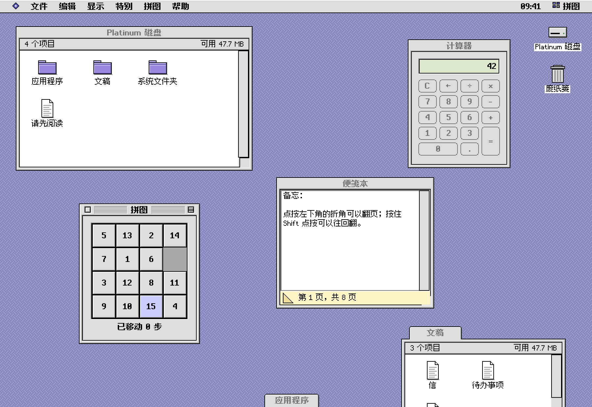

# mygo-platinum

[English](README.md) | 简体中文

[](https://github.com/firede/mygo-platinum/actions/workflows/verify.yml)
[](https://pkg.go.dev/github.com/firede/mygo-platinum)

一套为 [MyGo](https://mygo.egoist.dev) 原生 UI 编写的控件，风格取自上世纪
90 年代末灰色、带斜面立体感的 "Platinum" 桌面外观。所有控件都在 GPU 上逐像素
绘制，不使用 web view。仓库里还附带一个"经典桌面"示例，把这些控件实际用了
起来。


更多：[第 2 页](docs/gallery-2@2x.png)（斜面按钮、工具栏、输入框、状态类控件、
富文本、弹出窗口）、[第 3 页](docs/gallery-3@2x.png)（列表、表格、布局）、
[第 4 页](docs/gallery-4@2x.png)（日期、颜色、表格计算、标尺）、
[第 5 页](docs/gallery-5@2x.png)（文档与导航）。

> **仅为风格上的致敬。** 本项目与 Apple Inc. 没有任何关联，也未获其认可或
> 支持。项目没有使用 Apple 的任何字体、图标、图片或商标：西文点阵字体、所有
> 图标和图片都是为本项目原创绘制的，东亚文字字形来自开源的缝合像素字体，设计
> 规范（[docs/spec.md](docs/spec.md)）也是从零写成的。

> [!WARNING]
> **这是一个早期的个人项目。** 它为作者自用而写，按原样分享，不承诺提供支持。
> 0.x 版本之间 API 随时可能变化；它依赖的 MyGo v0.5.1 本身也还年轻、仍在
> 变化。请固定版本使用，并做好随之调整的准备。

## 包含哪些控件

| 控件 | 函数 |
|---|---|
| 按钮、默认按钮与取消按钮 | `Button` |
| 复选框（支持混合状态） | `Checkbox` |
| 单选按钮与单选组 | `Radio`、`RadioGroup` |
| 滑块（支持刻度） | `Slider` |
| 进度条，确定与不确定两种 | `ProgressBar` |
| 展开三角 | `Disclosure` |
| 分组框与分隔线 | `GroupBox`、`Separator` |
| 标签页控件 | `TabControl` |
| 弹出菜单 | `PopupMenu` |
| 文本框、密码框、多行文本区 | `TextField`、`TextArea` |
| 列表框（支持图标、灰显行） | `ListBox` |
| 滚动条 | `ScrollBar` |
| 窗口框架：条纹标题栏，关闭、缩放与折叠框，缩放角，路径菜单 | `Window` |
| 菜单栏、菜单、子菜单、快捷键 | `MenuBar` |
| 警告框、可移动的模态对话框 | `Alert`、`Dialog` |
| 用点阵字体绘制的文字 | `Label`、`TextIn`、`Paragraph` |
| 斜面按钮、图标按钮、开关、分段控件 | `BevelButton`、`IconButton`、`Segmented` |
| 带溢出菜单的工具栏 | `Toolbar` |
| 小箭头、数字框、搜索框 | `Stepper`、`NumberField`、`SearchField` |
| 旋转箭头、标牌、窗口头部、徽标、标签、图像槽 | `ChasingArrows`、`Placard`、`WindowHeader`、`Badge`、`Tag`、`ImageWell` |
| 帮助气球、右键菜单 | `Balloon`、`ContextMenu` |
| 树视图、可排序表格、图标视图 | `TreeView`、`Table`、`IconView` |
| 分栏、滚动视图、工具窗口 | `Split`、`ScrollView`、带 `Utility` 的 `Window` |
| 日历、日期选择器、时间输入框 | `Calendar`、`DatePicker`、`TimeField` |
| 组合框、颜色槽与取色器 | `ComboBox`、`ColorWell` |
| 带公式的电子表格、公式栏 | `Sheet`、`FormulaBar` |
| 查找替换对话框、标尺 | `FindReplace`、`Find`、`ReplaceAll`、`Ruler` |
| 分栏视图、文档标签页、字体选择器、页面设置 | `ColumnView`、`DocumentTabs`、`FontPicker`、`PageSetup` |
| 进度对话框、横幅、空状态 | `ProgressDialog`、`Banner`、`EmptyState` |
| 路径弹出菜单、面包屑、分页、卡片、状态栏 | `PathPopup`、`Breadcrumb`、`Pagination`、`Card`、`StatusBar` |
| 富文本：样式、四种字号、段落对齐；格式栏 | `RichTextArea`、`FormatBar`、`SizeMenu` |
| 停靠在底边的弹出窗口 | `PopupWindow`、`SpringOpen` |
| 打开与保存对话框 | `OpenDialog`、`SaveDialog` |
| 窗口打开时的缩放矩形动画 | `ZoomRects` |

每个控件都具备完整的状态（按下、禁用、聚焦、默认、选中、选定，以及位于后台
窗口时的非活动状态），可以完全用键盘操作，通过 MyGo 的无障碍支持向屏幕阅读器
描述自己，并且都有一个能编译运行的 godoc 示例。有独特外观的控件还导出了对应的
`Draw…` 函数，方便你画出外观一致的自定义控件。

## 使用

需要 Go 1.27.1 或更高版本，以及 MyGo v0.5.1。

```sh
go get github.com/firede/mygo-platinum@v0.1.0
```

```go
import (
	"github.com/egoist/mygo/ui"
	pt "github.com/firede/mygo-platinum"
)

func (app *state) view(c *ui.Context) {
	pt.Use(c, app.theme) // 传 nil 使用默认主题：灰色配薰衣草紫强调色
	ui.Column(c).Fill().Padding(12).Gap(8).Children(func() {
		pt.Checkbox(c, &app.sound, "Play alert sounds")
		pt.Slider(c, &app.volume, 0, 100).Label("Volume")
		pt.PopupMenu(c, &app.sort, "Sort by:", []string{"Name", "Date", "Size"})
		ui.Row(c).Gap(10).Children(func() {
			pt.Button(c, "Cancel").Cancel()
			if pt.Button(c, "OK").Default().Clicked() {
				app.apply()
			}
		})
	})
}
```

接受输入的控件返回一个 `*…Widget`，它的方法分两类：一类用来设置控件
（`Default`、`Disabled`、`Width`、`Label`…），一类用来查询用户的操作
（`Clicked`、`Changed`、`Submitted`、`Activated`）。请先调用设置方法，再调用
查询方法。值通过指针绑定，与 MyGo 自带控件的做法一致。只做展示的控件
（`ProgressBar`、`GroupBox`、`Separator`）直接返回 `ui.Element` 供布局使用。

内置六种强调色：Lavender、Graphite、Harbor、Moss、Ember 和 Orchid，通过
`Theme.Accent` 设置。

## 经典桌面



`examples/desktop` 在一个窗口里实现了一整套桌面：

- 带时钟和应用菜单的菜单栏；
- 可以打开、也可以拖进废纸篓的桌面图标；
- 可以移动、缩放、卷起、最大化，以及停靠到底边成为弹出窗口的窗口；
- 一个浏览自带小磁盘的文件浏览器：支持图标、按钮、列表、分栏四种视图，以及
  弹簧文件夹、按住 Option 拖动复制、显示简介、复制、放回原处、标题栏路径菜单，
  还有"查找文件"；
- 用这些控件搭出来的应用：计算器、便笺本、写字板（富文本编辑器，带样式、字号、
  标尺、查找替换和标准的打开/存储对话框）、账簿（电子表格）、拼图、闹钟，以及
  外观、日期与时间、语言、声音、鼠标五个控制面板。

桌面支持英文、简体中文、繁体中文、日文和韩文，跟随系统语言，也可以在"语言"控制
面板中选择。文字、日期与时间，以及东亚文字的地区字形都会随之切换，东亚文字使用
platinum-fonts 中 `cjk12` 的像素字体绘制。消息目录在 `examples/desktop/locales`。

桌面里所有的名称和图片都是原创的。

## 运行示例

```sh
go run ./examples/gallery                    # 在窗口中展示所有控件
go run ./examples/gallery -png gallery.png   # 不开窗口，直接渲染成图片
go run ./examples/desktop                    # 经典桌面
go run ./examples/desktop -png desk.png -lang ja   # 不开窗口渲染成图片，日文界面
```

## 测试

```sh
./scripts/verify.sh
```

这个脚本依次运行 `go vet`、`gofmt`、构建和全部测试，包括：

- 每个控件每种状态的快照，与 `testdata/golden` 中的 golden 图逐像素比对。另有
  测试会找出包里的所有控件，缺少快照或缺少示例都会失败；
- 能编译运行的示例；
- 尺寸和颜色是否符合 `docs/spec.md`；
- 通过 MyGo 无头测试器驱动的交互测试；
- 键盘焦点审查；
- 对示例投放随机输入；
- 示例的冒烟测试。

之后脚本会换一个时间点、换一个时区把全部测试再跑一遍，结果必须完全一致。
输出的最后一行是 `PASSED x/y`。

- 有意修改了控件外观后，先查看新图，确认无误再用 `go test -update`（在包目录
  或 `./examples/desktop` 中）写入新的 golden 图。
- 新增或重命名测试后，运行 `go run ./internal/verify -write-manifest` 更新
  `scripts/checks.txt`，也就是 `verify.sh` 预期要运行的检查清单。
- gallery 的 golden 图放在 `examples/gallery/testdata/golden`；`docs` 里的配图
  是两倍缩放渲染的，例如
  `go run ./examples/gallery -png docs/gallery-2@2x.png -scale 2 -page 2` 和
  `go run ./examples/desktop -png docs/desktop@2x.png -scale 2`（加上
  `-lang zh-Hans` 生成 `docs/desktop-zh-hans@2x.png`）。
- 修改 `examples/desktop/locales` 中的消息目录后，在 `examples/desktop` 目录运行
  `go run github.com/egoist/mygo/cmd/mygo generate` 重新生成 Go 函数。

## 说明

- 像素即 DIP：控件在任意整数倍缩放的显示器上都很清晰，在 2 倍屏上以 2×2 的
  像素块绘制。
- 文字使用 [platinum-fonts](https://github.com/firede/platinum-fonts) 的点阵
  字体绘制：Platinum Sans Bold（`SystemFont`）与 Platinum Sans Small
  （`AppFont`），覆盖 ASCII、常用标点、Latin-1 的全部字母（带重音的字母，以及
  Æ、Ð、Ø、Þ、Œ、ß）和最常用的中欧字母（Ł、Ś、Č、Ő、Ą…）。
- 东亚文字由应用选定后，使用 platinum-fonts 中 `cjk12` 的 12px 字体，按应用语言
  的地区字形绘制：

  ```go
  import "github.com/firede/platinum-fonts/cjk12/zhhans"

  pt.SetEastAsian(zhhans.Regular, zhhans.Bold)
  ```

  没有字体绘制的字符（调用之前的东亚文字、希腊文、其他带重音的字母）会用系统
  字体在同一基线上绘制，因此任何文字都可以输入和显示。
- 控件自身的文字（按钮、对话框、标签和屏幕阅读器读出的名称）提供英文、简体中文、
  繁体中文、日文和韩文，跟随窗口的语言；应用可以在自己的消息目录中用
  `platinum.<key>` 修改。日历、日期选择器和时间输入框按语言的习惯书写日期，并按
  用户的区域格式决定每周首日和 12/24 小时制，与 MyGo 自身的控件一致。
- 每个焦点位置都有供屏幕阅读器读出的名称；Tab 键可以在每个页面和窗口中循环，
  不会被困住；焦点之外的提示（例如横幅、搜索结果）也会被读出。这三点都有测试
  覆盖。

## 许可

MIT，详见 [LICENSE](LICENSE)。字体来自
[platinum-fonts](https://github.com/firede/platinum-fonts)，其字形数据采用 SIL Open
Font License 1.1。
