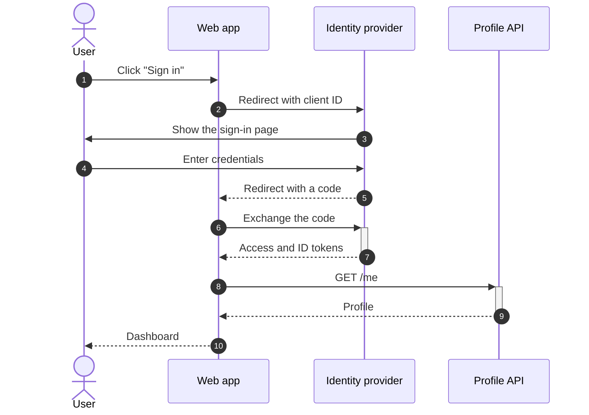
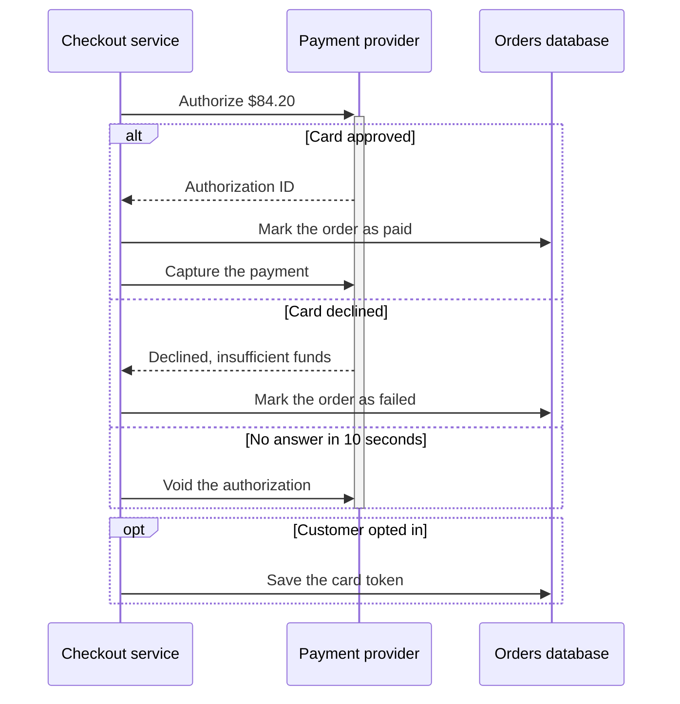
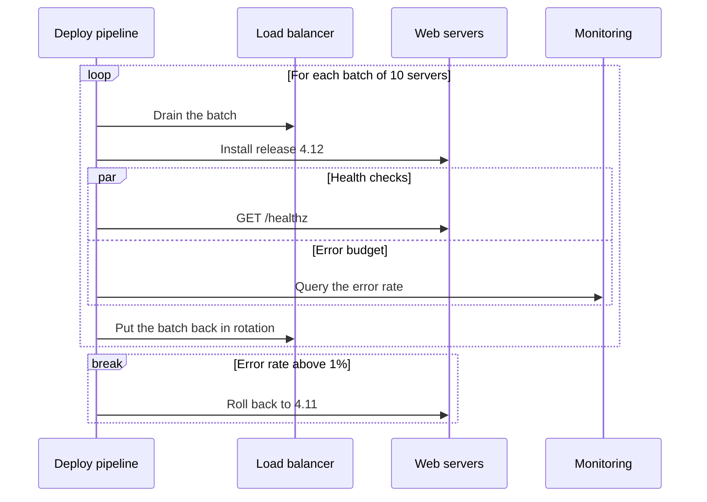
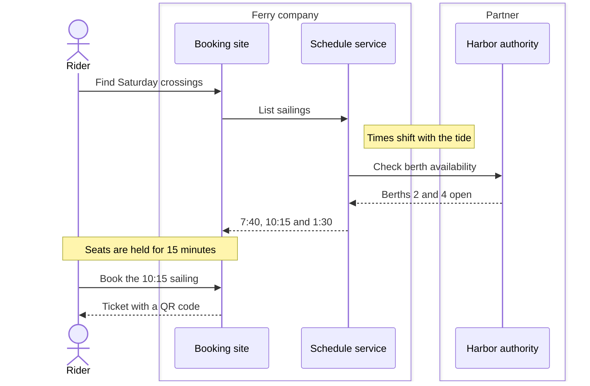
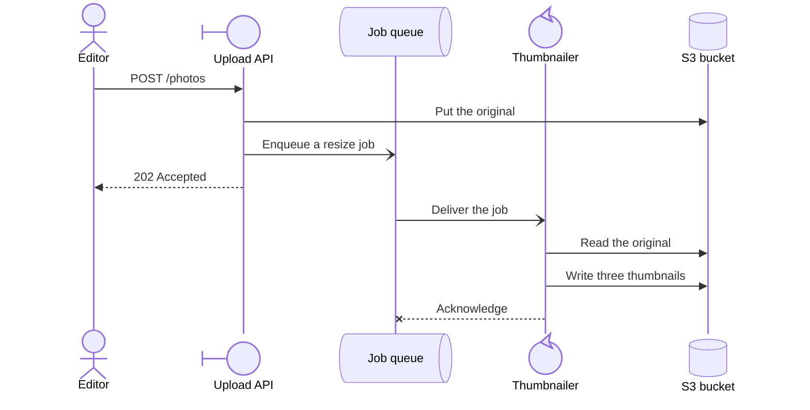
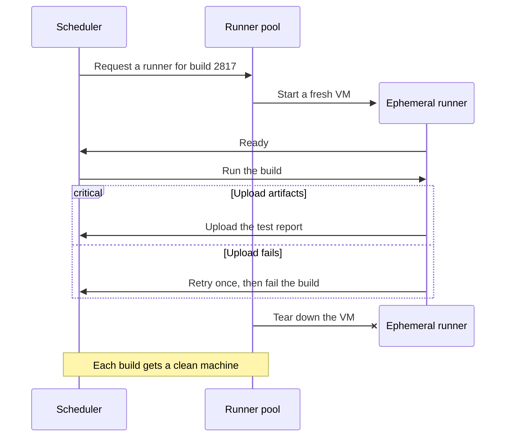
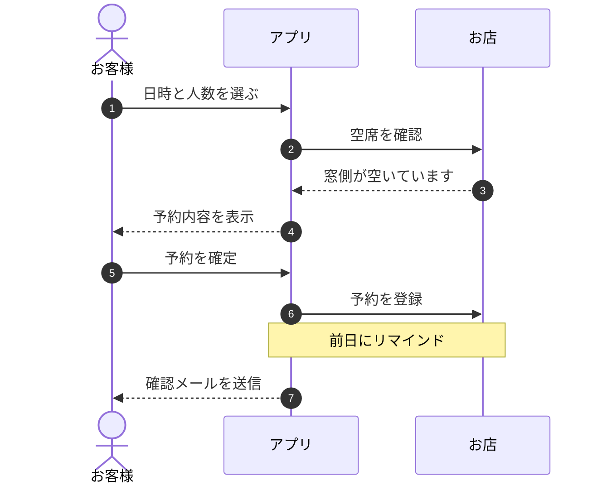

## Signing in with OAuth

## Paying for an order

## Loops and parallel steps in a rollout

## Notes and boxes for a ferry booking

## Participant types in an upload pipeline

## Creating and destroying participants

## Booking a table, in Japanese

